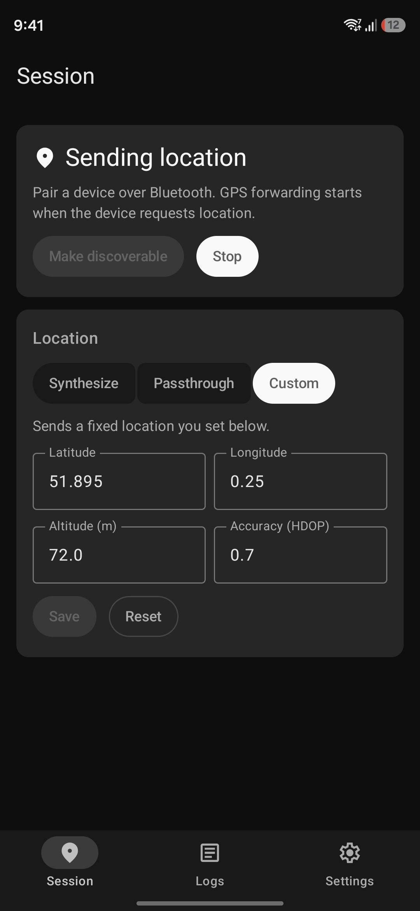
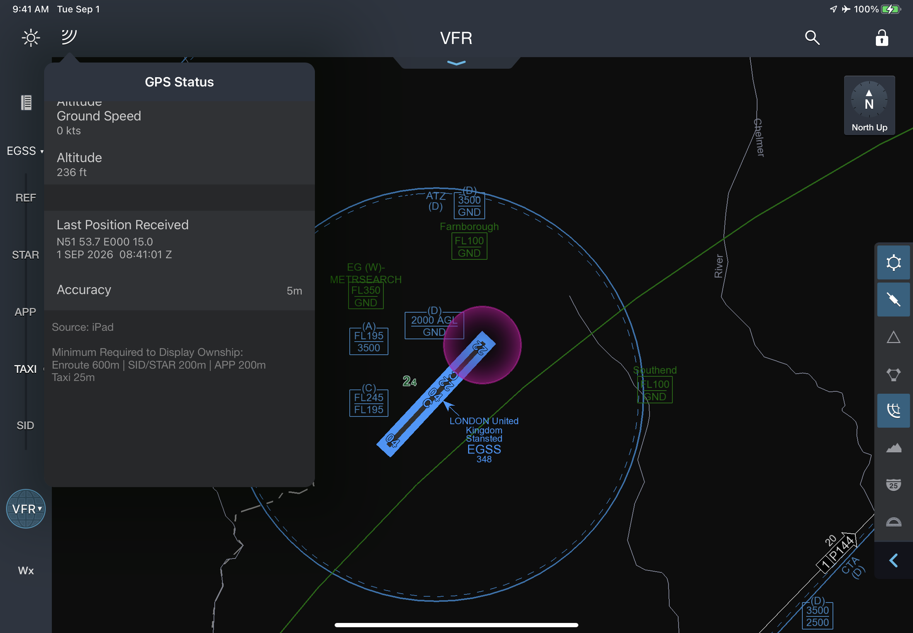
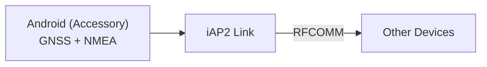

# Bluetooth GPS for Android

[](https://github.com/jqssun/android-bt-gps)
[](https://github.com/jqssun/android-bt-gps/releases)
[](https://github.com/jqssun/android-bt-gps/blob/main/LICENSE)
[](https://github.com/jqssun/android-bt-gps/actions/workflows/apk.yml)
[](https://github.com/jqssun/android-bt-gps/releases)

A free and open-source app that turns your Android device into a Bluetooth GPS receiver for Apple devices and others. It implements the Apple accessory protocol over Bluetooth, so they can use the Android device's real-time location as if it were an external GPS accessory. This is particularly useful for pilots flying with iPad models with no cellular connectivity.

Location can come from the device's GNSS fix, its NMEA output, or a custom position. Accessory identification is adjustable for better compatibility with other devices.

[](https://github.com/jqssun/android-bt-gps/releases/latest)

<p>
  
  
</p>

## Compatibility

- Android 6.0+ with Bluetooth
- Apple devices (including any iPad model)

## Implementation

The app listens for connections on a Bluetooth RFCOMM socket and is compatible with the iAP2 link layer and control session. After identification, location is streamed as NMEA sentences in `LocationInformation` messages whenever the Apple device requests it.



```bash
./gradlew assembleDebug
```

See the [CI](https://github.com/jqssun/android-bt-gps/blob/main/.github/workflows/apk.yml) for release builds.

---

Disclaimer: This project is not affiliated with Apple Inc.
